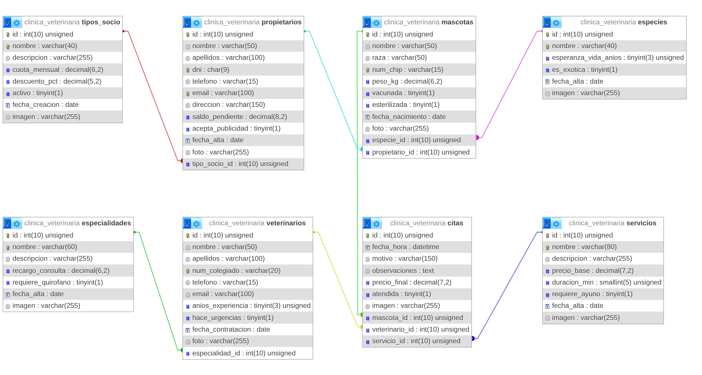

# Clínica veterinaria Carlitos & Snoopy

Aplicación web en **PHP + Bootstrap 5 + MySQL** para gestionar una clínica veterinaria:
propietarios, mascotas, veterinarios y citas, con sus tablas auxiliares (tipos de socio,
especies, especialidades y servicios).

Práctica evaluable UD1 PHP · Aplicaciones híbridas y en entorno servidor · 2º DAM.

## Enlaces

| | |
|---|---|
| **GitHub** | https://github.com/AlvFerMon/bootstrap |
| **Alojamiento web** | https://bootstrap-psi-plum.vercel.app |

## Grupo y entidades

| Alumno | Entidad de la que es responsable |
|---|---|
| _Nombre y apellidos_ | Propietarios (+ tipos de socio) |
| _Nombre y apellidos_ | Mascotas (+ especies) |
| _Nombre y apellidos_ | Veterinarios (+ especialidades) |
| _Nombre y apellidos_ | Citas (+ servicios) |

## Conexión a la base de datos

### En local (MySQL): la que se entrega en `sql/backup.sql`

| Dato | Valor |
|---|---|
| Servidor | `localhost` (con Docker: `db`, puerto `3307` desde el equipo) |
| Base de datos | `clinica_veterinaria` |
| Usuario | `clinica` |
| Contraseña | `clinica` |
| Usuario administrador (phpMyAdmin) | `root` / `root` |

Los valores se leen en `config.php` desde variables de entorno (`MYSQL_*` o `DB_*`) y, si no
existen, se usan los de la tabla.

### En el alojamiento (Vercel + Supabase)

Vercel no ofrece MySQL, así que la versión publicada usa la misma base de datos traducida a
PostgreSQL en Supabase (`supabase/schema.sql`, con los mismos datos). El código es el mismo:
solo cambia el driver de PDO según las variables de entorno de Vercel.

| Variable | Valor |
|---|---|
| `DB_DRIVER` | `pgsql` |
| `DB_HOST` | `aws-0-eu-west-1.pooler.supabase.com` |
| `DB_PORT` | `6543` |
| `DB_NAME` | `postgres` |
| `DB_USER` | `postgres.iyettsidquvnhvozwqym` |
| `DB_PASSWORD` | contraseña de la base de datos de Supabase (no se publica) |
| `SUPABASE_URL` | `https://iyettsidquvnhvozwqym.supabase.co` |
| `SUPABASE_SERVICE_KEY` | clave `service_role` de Supabase (no se publica) |

En Vercel el disco es de solo lectura, por eso las imágenes que se suben desde los formularios
se guardan en el bucket público `imagenes` de Supabase Storage. En local se guardan en
`img/subidas/`.

## Estructura

```
www/                      ← carpeta del proyecto (nombreProyecto)
├── index.php             página principal: resumen y accesos directos
├── config.php            configuración de la conexión a la base de datos
├── listado.php           listado sin parametrizar (todos los registros)
├── filtrar.php           listado parametrizado (formulario de filtros)
├── consulta.php          consulta por un campo relevante + ficha del registro
├── alta.php              alta de registros (desplegables cargados de la BD + imagen)
├── modificar.php         modificación de un registro buscado previamente
├── borrar.php            borrado por ID, por otro campo o eligiéndolo de una lista
├── inc/                  tablas.php (definición de las tablas), funciones.php,
│                         componentes.php, cabecera.php y pie.php
├── css/ js/              estilos y scripts propios
├── img/                  imágenes de ejemplo de cada registro (img/<tabla>/<id>.png)
└── sql/
    ├── backup.sql        estructura, relaciones y datos (≥ 10 registros por tabla)
    └── diagrama_ER.png   diagrama E-R generado con el diseñador de phpMyAdmin
api/index.php             punto de entrada para Vercel
supabase/schema.sql       la misma base de datos en PostgreSQL
docker-compose.yml        entorno local: Apache + PHP 8.3, MySQL 8 y phpMyAdmin
```

Todas las páginas reciben la tabla en la URL (`?t=mascotas`, `?t=citas`...). Los campos,
búsquedas y filtros de cada tabla se describen en `inc/tablas.php`.

## Base de datos

8 tablas relacionadas 1:N. Todas tienen PK entera autoincrementada, un número que no es PK
ni FK, una cadena de texto, un booleano, una fecha y la ruta de su imagen.

```
tipos_socio    1 ──< N propietarios
propietarios   1 ──< N mascotas       >── 1 especies
especialidades 1 ──< N veterinarios
mascotas       1 ──< N citas
veterinarios   1 ──< N citas
servicios      1 ──< N citas
```



## Funcionalidades (para cada tabla)

- **Alta**: formulario con desplegables cargados de la base de datos, validación en el
  navegador y en el servidor (DNI con letra, correos, rangos, fechas, campos únicos...) e
  imagen obligatoria con vista previa.
- **Consulta**: búsqueda por un campo relevante (DNI, apellidos, nº de chip, nº de colegiado,
  fecha de la cita...) y ficha con todos los datos.
- **Modificación**: primero se busca el registro y después se edita; la imagen es opcional
  (si no se elige se conserva la actual).
- **Borrado**: por clave primaria, por otro campo único (DNI, nº de colegiado, nº de chip,
  nombre) o eligiéndolo en una lista. Antes de borrar se pide confirmación y se avisa si hay
  registros que dependen de él.
- **Listado completo** con la imagen de cada registro.
- **Listado con filtros**: texto, desplegables, sí/no y rangos de números o fechas.

## Cómo ejecutarlo en local

### Con Docker

```bash
cp .env.example .env
docker compose up -d
```

- Aplicación: http://localhost:8080
- phpMyAdmin: http://localhost:8081

La primera vez MySQL importa automáticamente `www/sql/backup.sql`. Para volver a cargar los
datos: `docker compose down -v && docker compose up -d`.

### Con XAMPP / WAMP

1. Copiar el contenido de `www/` a `htdocs/clinica`.
2. Importar `sql/backup.sql` en phpMyAdmin (crea la base de datos `clinica_veterinaria`).
3. Crear el usuario `clinica` / `clinica` con permisos sobre esa base de datos, o cambiar
   los valores por defecto de `config.php`.
4. Abrir http://localhost/clinica.

Requisitos: PHP 8.1 o superior con `pdo_mysql` (y `curl` si se usa Supabase Storage).
La carpeta `img/` debe tener permisos de escritura para guardar las imágenes subidas.
